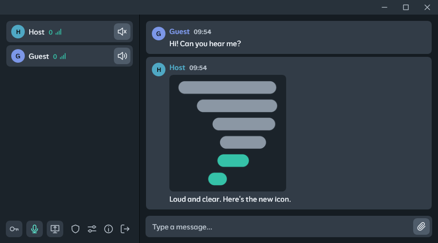

**[English](/README.md)** | **[Русский](/docs/README.ru.md)** | **[中文](/docs/README.zh.md)**

## Description

A lightweight, low-latency real-time communication application. Provides **voice chat, text chat, file transfer and hardware-accelerated screen sharing** in a single executable with an embedded server - no separate server installation required.

One participant hosts a session and shares the connection key, the others join with it. Files of any size are sent right in the chat and downloaded from the sender without being uploaded to a server first. Images and videos open in the built-in viewer. All traffic is encrypted, and the server only relays it without decrypting. The app works on a local network and over the internet with UPnP, ZeroTier or a dedicated Linux server.

<p align="center">
  
</p>

## Key Features

- **Voice chat** with noise suppression (RNNoise, DPDFNet) and push-to-talk
- **Text chat**
- **File transfer** - send any file to the chat; others download it straight from you through the server, with no upload step and no size limit; images and videos open in the built-in viewer, videos can be watched before the download finishes
- **Screen sharing** up to 1080p at 60 fps with hardware H.264 encoding and system audio
- **Host panel** - participants, kick, maximum screen share quality, file transfer speed limit
- **Encryption** - the server only relays messages, media and files and never decrypts them
- **Embedded server** - host a session in one click, or use the **dedicated Linux server**
- **UPnP port forwarding** and **automatic reconnect**
- **Per-user ping** next to every nickname

## System Components

### Client (WPF .NET 8)
- Dark theme with a custom title bar; English, Russian and Chinese localization
- WASAPI audio capture (microphone + system loopback) with RNNoise or DPDFNet noise suppression (ONNX Runtime)
- Opus codec (AUDIO mode, 32 kbps, 480-sample / 10 ms frames, PLC on packet loss)
- H.264 encode/decode via FFmpeg (avcodec, swscale)
- Desktop Duplication API capture (SharpDX) with cursor overlay
- Video player for attachments via FFmpeg (avformat, D3D11VA hardware decoding), reading the file as it downloads
- TCP/UDP network client with transparent reconnect

### Embedded Server (DLL .NET 8)
- Session creation, password verification, user management
- MSG/CMD packet routing - server never decrypts message content
- Media (audio/video) relay between participants
- File relay over a dedicated connection with a server-wide speed limit - file contents are never decrypted either
- Per-session AES session key, distributed via XOR with each client's ECDH shared secret
- Screen-share slot arbitration (one presenter at a time) and maximum screen share quality
- Per-user latency broadcast every second; kicked users are banned by address until the session ends

### Dedicated Linux Server
- Project: **[Talknado.Server.Linux](/Talknado.Server.Linux)** - built from the same server code as the embedded server, self-contained linux-x64 binary
- Session settings from the console, like the host panel: users, kick, maximum screen share quality, file bandwidth limit
- Installation:
```bash
curl -fsSL https://raw.githubusercontent.com/SodiumCXI/Talknado/main/Talknado.Server.Linux/install.sh | bash
```

## Security

The connection handshake runs in seven steps:

1. **Version check** - the server rejects clients older than 2.0.5 before any key material is shared and replies with its own version; the client refuses servers older than 1.2.5
2. **ECDH key exchange** - client and server exchange public keys; each independently derives the shared secret
3. **Password verification** - SHA-256(password) encrypted with AES-256-CBC using the shared secret
4. **Session key delivery** - server XORs the 32-byte session key with the client's unique shared secret; XOR is self-inverse, so no extra decryption step is needed
5. **Identity exchange** - username and assigned user ID, both encrypted with the session key
6. **UDP registration** - encrypted userId sent over LiteNetLib; server confirms with `#UCC`
7. **State sync** - server delivers participant list and current screen-share state

From step 4 onward all traffic - control, media and files - is encrypted with the session key (AES-256-CBC). The file connection opens with the user ID encrypted with the session key; file contents are encrypted by the sender and relayed as is. Screen-share frames are sent in parts, each with an 11-byte open header - frame number, keyframe flag, part number, part count and frame length - so the server can spread them over channels and skip frames for a slow viewer without decrypting them; the image itself stays encrypted.

## How to Use Over the Internet

### Option A - Automatic (UPnP)
When starting a server, check **"UPnP Port Forwarding"**. Talknado will attempt to map the port automatically via Open.NAT. The mapping is removed when the server stops. Requires a static public IP.

### Option B - ZeroTier (always works)
1. Install **[ZeroTier](https://www.zerotier.com/)** on each device.
2. All participants join the same ZeroTier network (Network ID).
3. Start Talknado and enter the connection key from the host's application.

### Option C - Dedicated Linux Server
Install the **[dedicated server](/Talknado.Server.Linux)** on a machine with a public IP, for example a VPS, and share the key from `talknado start`. The server picks a new port on every start, so incoming TCP and UDP connections must not be blocked by a firewall.
