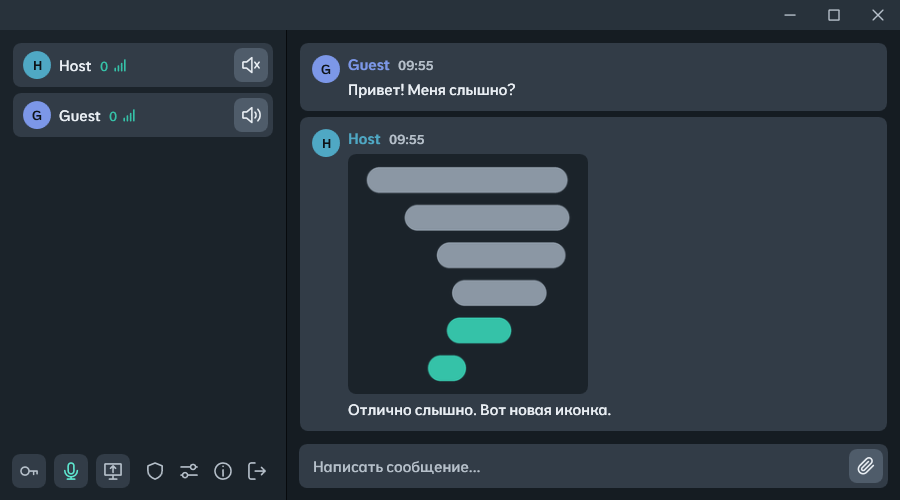

**[English](/README.md)** | **[Русский](/docs/README.ru.md)** | **[中文](/docs/README.zh.md)**

## Описание

Легковесное приложение для связи в реальном времени с низкой задержкой. Обеспечивает **голосовую связь, текстовый чат, передачу файлов и аппаратно-ускоренную демонстрацию экрана** в одном исполняемом файле со встроенным сервером - отдельная установка сервера не требуется.

Один участник создаёт сессию и раздаёт ключ подключения, остальные входят по нему. Файлы любого размера отправляются прямо в чат и скачиваются у отправителя без предварительной загрузки на сервер. Картинки и видео открываются во встроенном просмотре. Весь трафик зашифрован, сервер только пересылает его и не расшифровывает. Приложение работает в локальной сети и через интернет с помощью UPnP, ZeroTier или отдельного сервера для Linux.

<p align="center">
  
</p>

## Основные возможности

- **Голосовая связь** с шумоподавлением (RNNoise, DPDFNet) и режимом рации
- **Текстовый чат**
- **Передача файлов** - любой файл отправляется в чат; остальные скачивают его прямо у отправителя через сервер, без предварительной загрузки и ограничения размера; картинки и видео открываются во встроенном просмотре, видео можно смотреть, не дожидаясь конца загрузки
- **Демонстрация экрана** до 1080p при 60 fps с аппаратным кодированием H.264 и звуком системы
- **Панель хоста** - участники, исключение, максимальное качество демонстрации, предел скорости передачи файлов
- **Шифрование** - сервер только пересылает сообщения, медиа и файлы и не расшифровывает их
- **Встроенный сервер** - сессия создаётся в один клик, или **выделенный сервер для Linux**
- **Проброс портов UPnP** и **автоматическое переподключение**
- **Пинг каждого участника** рядом с ником

## Компоненты системы

### Клиент (WPF .NET 8)
- Интерфейс с тёмной темой и собственной полосой заголовка; английская, русская и китайская локализация
- Захват аудио WASAPI (микрофон + системный loopback) с подавлением шума RNNoise или DPDFNet (ONNX Runtime)
- Кодек Opus (режим AUDIO, 32 кбит/с, кадры 480 сэмплов / 10 мс, PLC при потере пакетов)
- Кодирование/декодирование H.264 через FFmpeg (avcodec, swscale)
- Захват экрана через Desktop Duplication API (SharpDX) с наложением курсора
- Плеер видео во вложениях на FFmpeg (avformat, аппаратное декодирование D3D11VA), читает файл по мере загрузки
- Сетевой клиент TCP/UDP с прозрачным переподключением

### Встроенный сервер (DLL .NET 8)
- Создание сессий, проверка пароля, управление пользователями
- Маршрутизация пакетов MSG/CMD - сервер никогда не расшифровывает содержимое сообщений
- Ретрансляция медиа (аудио/видео) между участниками
- Пересылка файлов по отдельному соединению с общим пределом скорости - содержимое файлов сервер тоже не расшифровывает
- Сессионный ключ AES для каждой сессии, распределяемый через XOR с общим секретом ECDH каждого клиента
- Арбитраж слота демонстрации экрана (один докладчик одновременно) и её максимальное качество
- Рассылка пинга каждого участника раз в секунду; исключённые участники блокируются по адресу до конца сессии

### Отдельный сервер для Linux
- Проект: **[Talknado.Server.Linux](/Talknado.Server.Linux)** - собирается из того же кода, что и встроенный сервер, автономный бинарник linux-x64
- Настройки сессии из консоли, как панель хоста: участники, исключение, максимальное качество демонстрации, предел скорости файлов
- Установка:
```bash
curl -fsSL https://raw.githubusercontent.com/SodiumCXI/Talknado/main/Talknado.Server.Linux/install.sh | bash
```

## Безопасность

Рукопожатие при подключении выполняется в семь этапов:

1. **Проверка версии** - сервер отклоняет клиентов старше 2.0.5 до обмена любыми ключами и сообщает свою версию; клиент отказывается от серверов старше 1.2.5
2. **Обмен ключами ECDH** - клиент и сервер обмениваются публичными ключами; каждая сторона независимо получает общий секрет
3. **Проверка пароля** - SHA-256(пароль) шифруется с помощью AES-256-CBC, используя общий секрет
4. **Передача сессионного ключа** - сервер выполняет XOR 32-байтового сессионного ключа с уникальным общим секретом клиента; XOR самообратим, поэтому дополнительный шаг расшифровки не требуется
5. **Обмен идентификацией** - имя пользователя и назначенный ID пользователя, оба зашифрованы сессионным ключом
6. **Регистрация UDP** - зашифрованный userId отправляется через LiteNetLib; сервер подтверждает с помощью `#UCC`
7. **Синхронизация состояния** - сервер передаёт список участников и текущее состояние демонстрации экрана

Начиная с шага 4, весь трафик (управляющий, медиа и файлы) шифруется сессионным ключом (AES-256-CBC). Соединение для файлов открывается с ID пользователя, зашифрованным сессионным ключом; содержимое файлов шифрует отправитель, а сервер пересылает его как есть. Кадры демонстрации идут частями, у каждой открыт заголовок в 11 байт - номер кадра, признак опорного кадра, номер и число частей, длина кадра: по нему сервер раскладывает части по каналам и пропускает их медленному зрителю, не расшифровывая; само изображение остаётся зашифрованным.

## Как использовать через интернет

### Вариант A - автоматический (UPnP)
При запуске сервера отметьте **"Проброс портов UPnP"**. Talknado попытается автоматически пробросить порт через Open.NAT. Проброс удаляется при остановке сервера. Требуется статический публичный IP.

### Вариант B - ZeroTier (работает всегда)
1. Установите **[ZeroTier](https://www.zerotier.com/)** на каждом устройстве.
2. Все участники присоединяются к одной сети ZeroTier (Network ID).
3. Запустите Talknado и введите ключ подключения из приложения хоста.

### Вариант C - отдельный сервер для Linux
Установите **[отдельный сервер](/Talknado.Server.Linux)** на машину с публичным IP, например VPS, и раздайте ключ из `talknado start`. Сервер при каждом запуске выбирает новый порт, поэтому входящие TCP- и UDP-соединения не должны блокироваться брандмауэром.
