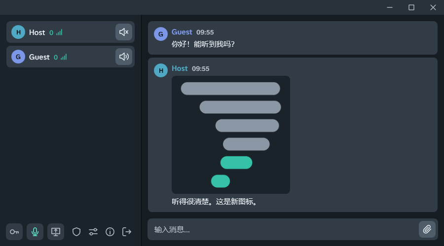

**[English](/README.md)** | **[Русский](/docs/README.ru.md)** | **[中文](/docs/README.zh.md)**

## 简介

一款轻量级、低延迟的实时通信应用程序。在单个可执行文件中提供**语音聊天、文字聊天、文件传输和硬件加速屏幕共享**功能，内置服务器 - 无需单独安装服务器。

一位参与者创建会话并分享连接密钥，其他人用该密钥加入。任意大小的文件都可以直接在聊天中发送，接收方直接从发送者处下载，无需先上传到服务器。图片和视频在内置查看器中打开。所有流量均经过加密，服务器只负责转发，不进行解密。应用可借助 UPnP、ZeroTier 或 Linux 专用服务器在局域网和互联网中使用。

<p align="center">
  
</p>

## 主要功能

- **语音聊天**，带降噪（RNNoise、DPDFNet）和按键通话
- **文字聊天**
- **文件传输** - 任何文件都可以发送到聊天中；其他人通过服务器直接从发送者处下载，无需预先上传，不限大小；图片和视频在内置查看器中打开，视频无需等待下载完成即可观看
- **屏幕共享**，最高 1080p 60 fps，硬件 H.264 编码，可共享系统声音
- **主机面板** - 参与者列表、踢出、屏幕共享最高画质、文件传输限速
- **加密** - 服务器只转发消息、媒体和文件，从不解密
- **内置服务器** - 一键创建会话，或使用 **Linux 专用服务器**
- **UPnP 端口转发**和**自动重连**
- **每位参与者的延迟**显示在昵称旁

## 系统组件

### 客户端（WPF .NET 8）
- 深色主题界面，自定义标题栏；支持英语、俄语和中文本地化
- WASAPI 音频捕获（麦克风 + 系统回环），带 RNNoise 或 DPDFNet 降噪（ONNX Runtime）
- Opus 编解码器（AUDIO 模式，32 kbps，480 采样 / 10 毫秒帧，丢包时使用 PLC）
- 通过 FFmpeg 进行 H.264 编码/解码（avcodec、swscale）
- 桌面复制 API 捕获（SharpDX），带光标叠加
- 基于 FFmpeg 的附件视频播放器（avformat，D3D11VA 硬件解码），边下载边读取文件
- TCP/UDP 网络客户端，支持透明重连

### 内置服务器（DLL .NET 8）
- 会话创建、密码验证、用户管理
- MSG/CMD 数据包路由 - 服务器永不解密消息内容
- 参与者之间的媒体（音频/视频）中继
- 通过独立连接转发文件，服务器统一限速 - 文件内容同样不解密
- 每个会话的 AES 会话密钥，通过与每个客户端的 ECDH 共享密钥进行 XOR 分发
- 屏幕共享槽位仲裁（一次只能有一个演示者）及最高画质
- 每秒广播每位参与者的延迟；被踢出的参与者在会话结束前按地址封禁

### 独立 Linux 服务器
- 项目：**[Talknado.Server.Linux](/Talknado.Server.Linux)** - 与内置服务器使用同一份代码构建，独立的 linux-x64 二进制文件
- 在控制台中管理会话，与主机面板相同：用户列表、踢出、屏幕共享最高画质、文件传输速率上限
- 安装方式：
```bash
curl -fsSL https://raw.githubusercontent.com/SodiumCXI/Talknado/main/Talknado.Server.Linux/install.sh | bash
```

## 安全性

连接握手分为七个步骤：

1. **版本检查** - 服务器在交换任何密钥之前拒绝低于 2.0.5 的客户端，并返回自身版本；客户端拒绝低于 1.2.5 的服务器
2. **ECDH 密钥交换** - 客户端和服务器交换公钥；各自独立推导出共享密钥
3. **密码验证** - 使用共享密钥通过 AES-256-CBC 加密 SHA-256(密码)
4. **会话密钥传递** - 服务器将 32 字节会话密钥与客户端唯一的共享密钥进行 XOR；XOR 是自逆运算，因此不需要额外的解密步骤
5. **身份交换** - 用户名和分配的用户 ID，均使用会话密钥加密
6. **UDP 注册** - 通过 LiteNetLib 发送加密的 userId；服务器用 `#UCC` 确认
7. **状态同步** - 服务器传递参与者列表和当前屏幕共享状态

从第 4 步开始，所有流量（控制、媒体和文件）都使用会话密钥（AES-256-CBC）加密。文件连接以会话密钥加密的用户 ID 建立；文件内容由发送方加密，服务器原样转发。屏幕共享帧分片发送，每片带有 11 字节的明文头部（帧序号、关键帧标记、分片序号、分片数和帧长度），服务器据此将分片分配到各通道，并为网速慢的观看者跳过帧，无需解密；画面本身仍保持加密。

## 如何通过互联网使用

### 方案 A - 自动（UPnP）
启动服务器时，勾选 **"UPnP 端口转发"**。Talknado 将尝试通过 Open.NAT 自动映射端口。服务器停止时映射将被移除。需要静态公网 IP。

### 方案 B - ZeroTier（始终有效）
1. 在每台设备上安装 **[ZeroTier](https://www.zerotier.com/)**。
2. 所有参与者加入同一个 ZeroTier 网络（Network ID）。
3. 启动 Talknado 并输入主机应用程序中的连接密钥。

### 方案 C - 独立 Linux 服务器
在具有公网 IP 的机器（例如 VPS）上安装 **[独立服务器](/Talknado.Server.Linux)**，并分发 `talknado start` 输出的密钥。服务器每次启动都会选择新的端口，因此防火墙不能阻止传入的 TCP 和 UDP 连接。
